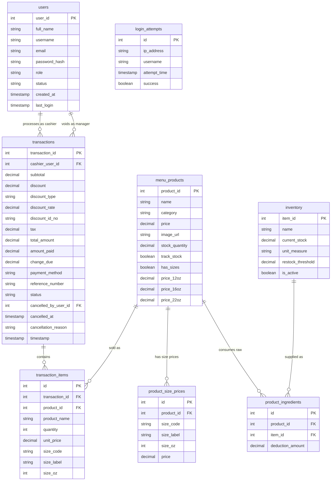

# CafeFlow – Point of Sale & Inventory Management System
### Custom Built for DK Cafe ☕

**CafeFlow** is an offline-first, single-screen Point of Sale (POS), Barista Queue, Raw Inventory Management, Staff Administration, and Executive Sales Reporting system designed specifically for **DK Cafe**.

Built with vanilla PHP 8, modern modular JavaScript (ES6+), and MySQL/MariaDB, it runs entirely on a local network via XAMPP—requiring **no internet connection, no external cloud subscriptions, and no proprietary POS hardware**.

---

## 🌟 Key Features

### 1. Dynamic Cup Size Pricing (12oz Hot, 16oz Cold / Tall & 22oz Grande)
- **Coffee Cup Sizes**: In accordance with DK Cafe's official menu, all **Coffee** category beverages exclusively offer **12oz Hot** and **16oz Cold** (22oz is completely omitted from Coffee).
- **Non-Coffee Beverage Sizes**: Other beverage categories (Milk Tea, Milk Series, Fruit Tea / Lemonade) offer **16oz (Tall)** and **22oz (Grande)**.
- **Interactive Size Popover**: Tapping any beverage opens an intuitive cup-size selector with visual cup icons, exact prices, and real-time stock indicators.
- **Card Price Range Display**: Menu cards cleanly display the pricing span (e.g., `₱130.00 – ₱150.00`), maintaining a tidy, uncluttered grid layout.
- **Full System Consistency**: Chosen cup sizes flow seamlessly into checkout totals, e-receipts, printed thermal receipts, the barista queue, and sales reports.

### 2. Centralized Recipe Engine & Raw Inventory Consumption
- **Pure Raw Inventory Tracking**: Eliminates disconnected "finished beverage" stock counts. Stock availability is derived 100% from actual raw ingredients (beans, milk, powders, syrups, ice, cups, lids, and straws).
- **Hot vs. Cold Serving Logic**:
  * **12oz Hot Beverages**: Deduct `12oz Hot cup & lid` (Item ID 23) and scaled espresso/milk ingredients, automatically omitting Ice and straws.
  * **16oz & 22oz Cold Beverages**: Deduct `16oz cup` or `22oz cup`, `Flat lid`, `Bendable straw`, `Ice`, and scaled ingredients.
- **Proportional Scaling**: Larger cup sizes (22oz Grande) automatically consume proportionally more raw ingredients (~1.375×) than baseline servings (16oz Tall), while 12oz servings scale by 0.75×.
- **Automated Packaging Deductions**: Every cup sold automatically deducts its corresponding cup size (`16oz cup` or `22oz cup`), `Flat lid`, and straw upon completion.
- **Centralized Engine (`core/recipe_engine.php`)**: All ingredient ratios, volume multipliers, and standard recipes are organized in one centralized file for easy future calibration.
- **Atomic Completion Deductions**: Deductions occur exclusively when the barista marks an order as **Completed**, utilizing database row-level locking (`FOR UPDATE`) to ensure zero double-deductions and prevent negative balances.

### 3. Smart Per-Size Inventory Availability
- **Independent Size Stock Checks**: If 16oz cups run out (`0 pcs`) but 22oz cups remain in stock (e.g., `500 pcs`), the beverage is **not** locked out. The card displays a `Grande only` badge and remains orderable.
- **Visual Popover Guards**: Inside the size picker, depleted sizes are automatically disabled, styled in muted tones, and marked **"OUT OF STOCK"**, while available sizes remain active.
- **Total Stock Protection**: If a core shared ingredient (such as Espresso Beans or Matcha Powder) reaches zero, the entire product card is flagged `Out of stock` and disabled with clear feedback toasts.

### 4. Cashier POS, Non-VAT Pricing & Payment Processing
- **Non-VAT Financial Model**: Clean, transparent pricing with 0% VAT. Product prices reflect the exact net customer charge.
- **Senior Citizen & PWD 20% Discount**: Accurate 20% statutory discount computed directly on the gross subtotal with mandatory OSCA / PWD ID or Booklet number verification (minimum 3 characters required).
- **Custom Promotional Discounts**: Flexible promotional discounts (custom % from 1% to 50%) for seasonal marketing campaigns.
- **Cash Tender Modal**: Fast cash calculator that compares amount tendered against order total, displaying change due in real time with quick-action tender shortcuts.
- **GCash Digital Payment & Anti-Fraud Security**: Native GCash payment tender with server-enforced duplicate reference number prevention (`HTTP 409 Conflict`) to protect the cafe from fraudulent double-redemptions.
- **E-Receipt & Thermal Print**: Instant electronic receipts with re-print capabilities and optimized CSS for 58mm/80mm thermal receipt printers.

### 5. Live Barista Queue
- **Real-Time Auto-Refresh**: Polls the server every 3 seconds for new orders with zero flicker.
- **Visual Wait-Time SLA Badges**: Color-coded wait-time indicators (🟢 Green < 5 min, 🟡 Amber < 10 min, 🔴 Red > 10 min) to maintain quick service times.
- **Size-Explicit Order Details**: Orders display clear brewing instructions (e.g., `Matcha (Tall - 16oz) x 2`) so baristas immediately know which cup size to prepare.
- **Single-Tap Fulfillment**: Tapping **Mark Complete** changes status to Completed and atomically triggers ingredient and packaging deductions.
- **Order Voiding & Cancellation**: Dedicated cancellation modal requiring a mandatory reason (e.g., customer change of mind, incorrect drink size), automatically reversing ingredient deductions if voided.

### 6. Standardized Contextual Empty State Architecture
- **Universal Component (`.cf-empty-state`)**: Replaces blank screens and ambiguous states across all 7 core modules with clear, actionable UI guidance:
  * **POS Cart**: 🛒 *Order is Empty* with Senior/PWD 20% discount reminder.
  * **Barista Queue**: ✨ *All Orders Served* with SLA wait-time guidelines.
  * **POS Menu**: ☕ *No items in category* / 🔍 *No products match query* with one-click filter clear button.
  * **Supplies Inventory**: 📦 *No Supplies Found* / 🔍 search no-match with restock threshold tips.
  * **Product Catalog**: 🏷️ *No Products Available* / 🔍 search no-match with recipe linking pro-tips.
  * **Account Management**: 👥 *No Accounts Found* / 🔍 search no-match with role-based permission context.
  * **Sales Reports**: 🏆 *No Items Sold*, 📊 *No Breakdown Data*, and 📋 *No Transaction Records* with calendar navigation tips.
- **Professional Input Placeholders & Microcopy**: Clear descriptive placeholder text across all search and tender inputs eliminating operational guesswork.

### 7. Product Catalog & Recipe Management Modal
- **Reference-Aligned Category Dropdown**: Dedicated `<select>` dropdown populated with DK Cafe's official menu categories (`Coffee`, `Croffle Classic`, `Croffle Premium`, `Fruit Tea / Lemonade`, `Milk Series`, `Milk Tea`, `Pastry`, `Sandwich`, `Snacks`).
- **Dynamic Form Intelligence**: Selecting a beverage category automatically enables the cup size and Hot/Cold pricing builder; selecting a food item automatically toggles to Single / Fixed Price.
- **Custom Ingredient Linking**: Add, edit, or map specific raw inventory supplies and precise deduction amounts directly in the product sheet.
- **Image Uploads**: Built-in image uploader with format validation, thumbnail generation, and fallback placeholder icons.

### 8. Raw Supplies Inventory Management
- **Instant Search & Status Filtering**: Real-time search bar (`🔍 Search supplies by name, unit (g, ml, pcs), or status (low, ok)...`) filtering across item names, units of measure, and stock status keywords (`out`, `low`, `ok`). Includes instant clear button (`✕`) and empty-state guidance.
- **Live Stock Table**: Monitor stock quantities, units of measure (`g`, `ml`, `pcs`), and real-time status pills (`OK`, `Low`, `Out`).
- **Restock & Adjustments**: Log delivery restocks, perform stock take adjustments, and set custom low-stock alert thresholds.
- **Quick-Add Supply Actions**: Introduce new raw ingredients and packaging with a dedicated `+ Add Supply` button in the inventory modal or via the in-product recipe drawer.

### 9. Executive Sales Analytics & Multi-Sheet Excel (.xlsx) Exports
- **Interactive Sales Analytics**: 6 executive KPI cards (Total Settled Sales, Completed Orders, Average Order Value, Total Discounts, Net Cash Drawer Tender, GCash Digital Sales), 3 Chart.js graphs, visual calendar drawer with quick presets (Today, Yesterday, Last 7 Days, This Month, Last Month), and itemized transaction ledger with live instant search.
- **Master 4-Worksheet Executive Sales Workbook (`DK_Cafe_Executive_Sales_*.xlsx`)**:
  * **Sheet 1 ('Executive Dashboard')**: Executive report banner in Deep Espresso (`#1F1610`), 6 high-contrast KPI cards, payment channel reconciliation, product category mix table, and an embedded native vector Doughnut Chart.
  * **Sheet 2 ('Itemized Sales Ledger')**: 21-column audit ledger with frozen header rows, auto-filters, alternating zebra striping, and dynamic `=SUBTOTAL(9, ...)` accounting rows that recalculate automatically when filtered.
  * **Sheet 3 ('Product Performance')**: Menu item popularity ranking with podium badges (🥇 #1, 🥈 #2, 🥉 #3), volume counts, revenues, and an embedded horizontal Bar Chart comparing Top 10 Best Sellers.
  * **Sheet 4 ('Raw Inventory & Stock Health')**: Complete stock audit tracking all 62 physical supplies with health pills (`HEALTHY`, `LOW STOCK`, `OUT OF STOCK`) and reorder directives.
- **Dedicated Standalone Inventory & Recipe Audit Workbook (`DK_Cafe_Inventory_Stock_Report_*.xlsx`)**:
  * **Sheet 1 ('Raw Supplies Inventory')**: Physical stock audit with KPI metrics, reorder thresholds, and active status.
  * **Sheet 2 ('Menu Recipe Mapping')**: Itemized recipe formula register mapping all 42 menu products to their 231 exact ingredient deductions and units of measure.
- **100% ECMA-376 OpenXML Compatibility**: Compatible with Microsoft Excel, Microsoft 365, Google Sheets, LibreOffice Calc, and mobile office suites (WPS Office, Samsung DeX) with frozen panes, print setup, and auto-fitted columns.

### 10. Modular Frontend JavaScript Architecture
- **Zero-Dependency Modular Design**: Decomposed from a legacy ~4,000-line monolithic file into 15 ES modules:
  * `core/config.js`, `core/state.js`, `core/utils.js`, `core/api.js`
  * `modules/pos-menu.js`, `modules/pos-cart.js`, `modules/pos-queue.js`, `modules/inventory.js`, `modules/products.js`, `modules/accounts.js`, `modules/reports.js`, `modules/receipt.js`, `modules/dashboard.js`, `modules/navigation.js`
  * `app.js` (orchestration and bootstrapping)
- **Zero Functional Regression**: Retained full `window.CafeFlow` namespace and global window bindings to seamlessly preserve HTML inline event compatibility (`window.loadReport`, `window.viewReceipt`, etc.).

### 11. Co-Branded Dual Logo Lockup (CafeFlow & DK Cafe)
- **Header Lockup**: Features a co-branded header lockup pairing the circular **CafeFlow** vector emblem on the left with the official **DK Cafe** logo on the right, joined by a sleek `CAFEFLOW & DK CAFE` pill badge matching professional corporate lockup guidelines.
- **Harmonized Color Palette**: Built on DK Cafe's brand colors:
  - Deep Forest Green (`#162318` / `#1b2e20`)
  - Warm Flame Orange / Caramel (`#e8623a` / `#c07c2e`)
  - Leaf Green (`#2a9b52`)
  - Warm parchment & cream surfaces for low eye strain during long cafe shifts.

---

## 📁 System Architecture & Directory Structure

```text
cafeflow_v5-1/
├── api/                           # Backend REST API Endpoints (JSON / Binary)
│   ├── accounts_api.php           # Staff account CRUD, role changes, password resets
│   ├── auth_api.php               # Login, session inspection, logout, brute-force rate limit
│   ├── cancel_order.php           # Cancels orders & reverses ingredient deductions
│   ├── checkout.php               # Validates cart, verifies raw inventory, creates orders
│   ├── complete_order.php         # Completes orders & atomically deducts raw ingredients
│   ├── export_excel.php           # Streams downloadable multi-sheet Excel (.xlsx) reports
│   ├── fetch_menu.php             # Serves menu cards with size pricing & stock status
│   ├── fetch_queue.php            # Serves pending barista queue items & low stock alerts
│   ├── inventory_api.php          # Raw supplies CRUD, stock counts, restock actions
│   ├── products_api.php           # Product management, recipe linking & image upload
│   ├── report.php                 # Analytics, date filtering & sales report data
│   └── transactions_api.php       # Past order lookups, receipts & live search filtering
├── assets/                        # Client-Side Frontend Assets
│   ├── css/                       # Modular Stylesheet Architecture
│   │   ├── auth.css               # Login, account management & profile styling
│   │   ├── base.css               # Reset, typography, utility classes
│   │   ├── cart.css               # POS cart drawer, steppers, discount layout
│   │   ├── inventory.css          # Raw inventory modal, table, threshold badges
│   │   ├── layout.css             # Main grid, contextual empty states (.cf-empty-state)
│   │   ├── modals.css             # Modal backdrops, header actions, sheet cards
│   │   ├── pos.css                # Cashier menu grid, category pills, item cards
│   │   ├── print.css              # 58mm/80mm thermal receipt printer styles
│   │   ├── products.css           # Product management form, cup size builder
│   │   ├── queue.css              # Barista preparation tickets & wait-time SLA badges
│   │   ├── reports.css            # Sales analytics, KPI cards, visual calendar drawer
│   │   ├── responsive.css         # Mobile and tablet responsive breakpoint adaptations
│   │   ├── style.css              # Master CSS bundler / loader
│   │   ├── topbar.css             # Header, dual brand lockup, connection indicator
│   │   └── variables.css          # Color tokens, spacing, typography variables
│   ├── js/                        # Modular JavaScript Architecture (ES6+)
│   │   ├── core/                  # Foundational Subsystems
│   │   │   ├── api.js             # Hardened fetch wrapper with auto CSRF injection
│   │   │   ├── config.js          # Global constants, currency formatting, endpoints
│   │   │   ├── state.js           # Centralized reactive application state store
│   │   │   └── utils.js           # DOM helpers, toast notifications, emptyState() component
│   │   ├── modules/               # Single-Responsibility Feature Modules
│   │   │   ├── accounts.js        # Staff administration & RBAC management
│   │   │   ├── dashboard.js       # Manager workspace KPI cards & quick links
│   │   │   ├── icons.js           # SVG icon definitions & helpers
│   │   │   ├── inventory.js       # Supplies table, restock modal, threshold alerts
│   │   │   ├── navigation.js      # View switching, modal lifecycle, keyboard esc
│   │   │   ├── pos-cart.js        # Cart management, discount math, Cash/GCash tender
│   │   │   ├── pos-menu.js        # Menu rendering, category scroll, size popover
│   │   │   ├── pos-queue.js       # Barista queue poller, ticket completion & voiding
│   │   │   ├── products.js        # Product catalog, multi-size pricing, recipe builder
│   │   │   ├── receipt.js         # Official E-Receipt generator & thermal print formatting
│   │   │   └── reports.js         # Sales analytics, KPI cards, charts, calendar drawer
│   │   ├── vendor/                # Vendored Offline Third-Party Libraries
│   │   │   └── chart.umd.min.js   # Local Chart.js library for offline vector charts
│   │   ├── app.js                 # Master bootstrap coordinator & event delegator
│   │   └── script.js              # Backward-compatibility legacy script facade
│   └── images/                    # System & Brand Graphics
│       ├── cafeflow_logo.svg      # Vector circular emblem for CafeFlow
│       ├── dk_cafe_logo.png       # Original official DK Cafe logo
│       └── dk_cafe_logo_cropped.png # Tightly-cropped DK Cafe lockup logo
├── core/                          # Central Backend Logic & Database
│   ├── auth.php                   # Authentication engine, RBAC checks, session security
│   ├── db.php                     # PDO connection, request helpers & schema verification
│   ├── excel_generator.py         # Multi-sheet openpyxl Excel workbook generator
│   └── recipe_engine.php          # Centralized recipe profiles, cup sizes & deduction logic
├── database/                      # SQL Schemas & Database Migrations
│   ├── archive/                   # Historical database migrations
│   └── schema.sql                 # Baseline database schema & seed data
├── docs/                          # Project Documentation & Release Changelogs
│   ├── CHANGES_2026-10-26.txt     # Initial technical changelog
│   ├── CHANGES_2026-11-06.txt     # Non-VAT model transition & UI expansion release
│   ├── CHANGES_2026-11-09.txt     # Multi-sheet Excel (.xlsx) overhaul release
│   ├── CHANGES_2026-11-11.txt     # Modular JS breakdown, empty states & full QA audit
│   └── SYSTEM_EXPANSION_SUGGESTIONS.txt # Architecture suggestions for academic courses
├── ref_materials/                 # Official DK Cafe Menu & Inventory Reference Sheets
├── tools/                         # Operational CLI Utilities
│   └── provision_user.php         # Out-of-band user account provisioning CLI
├── uploads/                       # Product Imagery & Uploads
│   └── products/                  # Consolidated product photography & menu image assets
├── index.php                      # Application Entry Point & Single-Screen Interface
├── login.php                      # Secure Authentication Gateway
├── logout.php                     # Session Termination & Redirection
└── README.md                      # Comprehensive System Guide & Documentation
```

---

## 🗄️ Database Schema Overview



---

## 🚀 Quick Installation Guide (XAMPP)

### Prerequisites
- **XAMPP** (Apache + MySQL/MariaDB + PHP 8.0 or higher)
- **Python 3.10+** (Required for presentation-grade `.xlsx` Excel exports with `openpyxl 3.1.5` installed via `pip install openpyxl`)
- Any modern web browser (Chrome, Edge, Firefox, Safari)

### Setup Steps

1. **Place Project in XAMPP Web Root**:
   Copy the project folder to your XAMPP `htdocs` directory:
   ```text
   C:\xampp\htdocs\cafeflow_v5-1\
   ```

2. **Start Servers**:
   Open the **XAMPP Control Panel** and start both **Apache** and **MySQL**.

3. **Database Initialization**:
   - Open your browser and navigate to: `http://localhost/phpmyadmin`
   - Create a new database named `cafeflow` (Collation: `utf8mb4_unicode_ci`).
   - Click the **Import** tab, choose `database/schema.sql` from the project directory, and click **Import**.
   - *Note*: `core/db.php` includes an automatic migration engine (`ensure_schema()`) that automatically checks and applies schema updates on first launch.

4. **Verify Configuration**:
   Open `core/db.php`. Default settings connect to MySQL on `127.0.0.1:3306` with user `root` and an empty password. Adjust constants if your environment uses custom credentials:
   ```php
   if (!defined('DB_HOST')) define('DB_HOST', '127.0.0.1');
   if (!defined('DB_NAME')) define('DB_NAME', 'cafeflow');
   if (!defined('DB_USER')) define('DB_USER', 'root');
   if (!defined('DB_PASS')) define('DB_PASS', '');
   ```

5. **Launch CafeFlow**:
   - **On the Host PC**: Open `http://localhost/cafeflow_v5-1/login.php` in your browser.
   - **On Tablets / Mobile (Same Local Wi-Fi)**:
     - Find the host PC's IP address by running `ipconfig` in Command Prompt (e.g. `192.168.1.100`).
     - On the tablet browser, navigate to: `http://192.168.1.100/cafeflow_v5-1/login.php`
     - Select **"Add to Home Screen"** in your mobile browser to run CafeFlow as a clean, full-screen progressive web app.

---

## 🔐 Authentication & Role-Based Access Control (RBAC)

CafeFlow enforces strict role-based access control across all frontend UI modules and backend API endpoints.

### Default Starter Accounts

| Role | Username | Password | Default Landing Page | Authorized Modules & Permissions |
|---|---|---|---|---|
| **Barista** | `barista` | `barista123` | **Dual POS Screen** (`index.php`) | **Full POS Operations**, Order Taking, Cash/GCash Tender, Barista Queue Preparation, Product Management, Raw Supplies View/Restock, Sales Reports (Shift View). Strictly blocked from Account Management (`HTTP 403 Forbidden`). |
| **Manager** | `manager` | `manager123` | **Manager Dashboard** (`index.php`) | **Executive Dashboard**, **Raw Inventory Management**, **Executive Sales Reports** (Historical date analysis, visual charts, multi-sheet Excel exports), **Staff Account Administration** (Create, reset passwords, activate/deactivate, role assignment). Strictly blocked from POS Cashier order processing. |
| **Active Barista** | `tan_smsn` | `alcaraz030303` | **Dual POS Screen** (`index.php`) | Active Barista account (Tristan Alcaraz). |

### Authorized Account Provisioning (No Public Registration)
Public self-registration is permanently disabled. CafeFlow operates strictly as an enterprise, closed-system POS where accounts are provisioned exclusively through authorized channels:
1. **In-App Manager Provisioning**: An authenticated Manager signs in (`manager` / `manager123`), opens the **Profile Menu** -> **Account Management**, clicks **"+ Add Employee"**, and provisions new Barista or Manager credentials with immediate active status.
2. **CLI Account Provisioning Tool**: Authorized system administrators can provision or reset accounts out-of-band using the secure CLI utility:
   ```bash
   php tools/provision_user.php --username=new_user --role=barista --password=secret123 --name="New Employee"
   # Or run interactively:
   php tools/provision_user.php --interactive
   ```
3. **Backend Restriction**: All unauthorized registration attempts via direct API calls (`action=register`) or forged HTTP requests are strictly rejected with `HTTP 403 Forbidden`.

---

## 📋 Daily Cafe Operations Workflow

### 1. Cashier (Order Taking & Checkout)
1. Tap a beverage from the menu grid.
2. If the product has multiple sizes, the cup size popover appears:
   - Select **12oz Hot**, **16oz Tall**, or **22oz Grande**.
   - Depleted sizes are clearly indicated and disabled.
3. Review the order in the **Current Order** cart. Adjust quantities using `+` or `−`.
4. If the customer is a Senior Citizen or PWD, select **Senior / PWD (20% Discount)** from the discount dropdown and enter their OSCA / PWD ID or Booklet number.
5. Tap **💵 Checkout · Cash** or **📱 Checkout · GCash**:
   - For **Cash**: The Cash Tender dialog appears. Enter the amount received (or use quick-cash buttons). The exact change due is calculated automatically.
   - For **GCash**: Enter the customer's GCash receipt reference number (minimum 6 digits).
6. Tap **Confirm Payment**. The transaction is recorded, an official e-receipt is generated, and the order is instantly pushed to the barista queue.

### 2. Barista (Order Preparation & Inventory Deduction)
1. The right-hand **Barista Queue** automatically updates every 3 seconds.
2. The barista views the customer queue with exact drink specifications (e.g., `Spanish Latte (Grande - 22oz) x 1`).
3. Once the drink is brewed and served, the barista taps **✓ Mark Complete**.
4. The system automatically marks the transaction `Completed` and deducts:
   - Specific cup (`22oz cup`) and `Flat lid`
   - Coffee beans, milk, and specialty syrups scaled to the 22oz serving size.

### 3. Inventory Monitoring & Restocking
1. The **Inventory** button in the header features an alert badge displaying the number of supplies at or below their restock threshold.
2. Open the **Raw Supplies Inventory** modal to:
   - Search supplies by name, unit (`g`, `ml`, `pcs`), or status (`low`, `ok`).
   - Log restock deliveries by entering quantities added.
   - Perform periodic stock takes and enter reconciled counts.
   - Set warning alert thresholds (e.g., alert when 16oz cups drop below 50 pcs).
   - Export standalone physical stock audits to Excel via **📥 Export Excel**.

### 4. End-of-Day Sales Reporting & Accounting
1. Open the **Sales Report** modal.
2. Select the desired period (**Today**, **Specific Date**, **7-Day Report**, or **Specific Month**), or use the visual calendar drawer.
3. Review total gross sales, completed order count, Cash vs. GCash breakdown, and top-selling beverages.
4. Click **📥 Export Excel (.xlsx)** to download the presentation-grade 4-worksheet master sales workbook for accounting and management review.

---

## 🛠️ Customizing Recipes & Ingredient Measurements

To calibrate recipes or update ingredient estimates as measurements are refined, edit [`core/recipe_engine.php`](core/recipe_engine.php).

### Standard Cup Size Scale Multipliers
```php
const RECIPE_CUP_SIZES = [
    '12oz' => [
        'code'        => '12oz',
        'label'       => 'Hot',
        'oz'          => 12,
        'scale'       => 0.75,             // Scaled for 12oz Hot serving
        'cup_pattern' => '12oz Hot cup & lid',
        'lid_pattern' => null,             // Lid integrated into cup packaging
        'straw'       => null,             // Hot drinks do not serve straws
    ],
    '16oz' => [
        'code'        => '16oz',
        'label'       => 'Tall',
        'oz'          => 16,
        'scale'       => 1.00,             // Baseline scale (1.0x)
        'cup_pattern' => '16oz cup',       // Inventory supply match
        'lid_pattern' => 'Flat lid',
        'straw'       => 'Bendable straw',
    ],
    '22oz' => [
        'code'        => '22oz',
        'label'       => 'Grande',
        'oz'          => 22,
        'scale'       => 1.375,            // 37.5% larger volume
        'cup_pattern' => '22oz cup',
        'lid_pattern' => 'Flat lid',
        'straw'       => 'Bendable straw',
    ],
];
```

### Adjusting Recipe Profiles
In `ESTIMATED_CONSUMPTION_PROFILES`, specify exact quantities for servings:
```php
'matcha' => [
    'items' => [
        ['name' => 'Matcha Powder',   'qty_16oz' => 15.0,  'qty_22oz' => 22.0,  'unit' => 'g'],
        ['name' => 'Full Cream Milk', 'qty_16oz' => 180.0, 'qty_22oz' => 250.0, 'unit' => 'ml'],
        ['name' => 'Ice',             'qty_16oz' => 120.0, 'qty_22oz' => 160.0, 'unit' => 'g'],
    ],
    'requires_cup'   => true,
    'requires_lid'   => true,
    'requires_straw' => true,
],
```
When adjusting measurements, simply update the quantities in this array. All stock calculations, inventory deductions, and POS availability checks will automatically reflect the updated values across the entire system.

---

## 🔒 Security & Offline Reliability
- **Strict Input Validation**: All POST requests validate numeric types, sanitize string inputs, and guard against SQL injection via PDO parameterized queries.
- **CSRF Defense**: All mutating requests auto-attach and validate session-scoped `X-CSRF-Token` headers.
- **Centavo Precision**: All financial calculations are evaluated in whole integer centavos internally to avoid floating-point rounding discrepancies.
- **Race Condition Prevention**: Order completion uses `FOR UPDATE` transaction locks to ensure inventory counts remain synchronized even during simultaneous order completions.
- **Brute-Force Rate Limiting**: Centralized `login_attempts` tracking with IP-based and username-based lockout thresholds (maximum 5 failed attempts in 15 minutes).
- **100% Offline Capable**: Zero external CDN dependencies, remote fonts, or third-party cloud APIs. All assets, SVGs, styles, and Chart.js scripts reside locally in the repository.

---

*Developed for DK Cafe — Simple, Fast, and Reliable POS & Inventory Management.*
