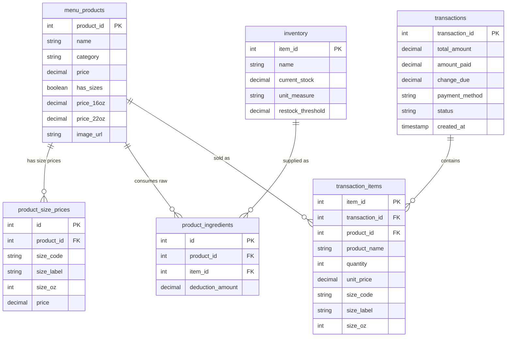

# CafeFlow v5.1 – Point of Sale & Inventory Management System
### Custom Built for DK Cafe ☕

**CafeFlow** is an offline-first, single-screen Point of Sale (POS), Barista Queue, Raw Inventory Management, and Sales Reporting system designed specifically for **DK Cafe**.

Built with vanilla PHP 8, modern JavaScript (ES6+), and MySQL/MariaDB, it runs entirely on a local network via XAMPP—requiring **no internet connection, no external cloud subscriptions, and no proprietary POS hardware**.

---

## 🌟 Key Features

### 1. Dynamic Cup Size Pricing (Tall 16oz & Grande 22oz)
- **Per-Size Pricing**: Beverages support dual cup sizes—**16oz (Tall)** and **22oz (Grande)**—with independent prices defined per product.
- **Interactive Size Popover**: Tapping any beverage opens an intuitive cup-size selector with visual cup icons, exact prices, and real-time stock indicators.
- **Card Price Range Display**: Menu cards cleanly display the pricing span (e.g., `₱130.00 – ₱150.00`), maintaining a tidy, uncluttered grid layout.
- **Full System Consistency**: Chosen cup sizes flow seamlessly into checkout totals, e-receipts, printed thermal receipts, the barista queue, and sales reports.

### 2. Centralized Recipe Engine & Raw Inventory Consumption
- **Pure Raw Inventory Tracking**: Eliminates disconnected "finished beverage" stock counts. Stock availability is derived 100% from actual raw ingredients (beans, milk, powders, syrups, ice, cups, lids, and straws).
- **Proportional Scaling**: Larger cup sizes (22oz Grande) automatically consume proportionally more raw ingredients (~1.375×) than standard servings (16oz Tall).
- **Automated Packaging Deductions**: Every cup sold automatically deducts its corresponding cup size (`16oz cup` or `22oz cup`), `Flat lid`, and straw upon completion.
- **Centralized Engine (`recipe_engine.php`)**: All ingredient ratios, volume multipliers, and standard recipes are organized in one centralized file for easy future calibration.
- **Atomic Completion Deductions**: Deductions occur exclusively when the barista marks an order as **Completed**, utilizing database row-level locking (`FOR UPDATE`) to ensure zero double-deductions and prevent negative balances.

### 3. Smart Per-Size Inventory Availability
- **Independent Size Stock Checks**: If 16oz cups run out (`0 pcs`) but 22oz cups remain in stock (e.g., `500 pcs`), the beverage is **not** locked out. The card displays a `Grande only` badge and remains orderable.
- **Visual Popover Guards**: Inside the size picker, depleted sizes are automatically disabled, styled in muted tones, and marked **"OUT OF STOCK"**, while available sizes remain active.
- **Total Stock Protection**: If a core shared ingredient (such as Espresso Beans or Matcha Powder) reaches zero, the entire product card is flagged `Out of stock` and disabled with clear feedback toasts.

### 4. Cashier POS & Payment Processing
- **Responsive Menu Grid**: Categorized menu with instant search filtering, high-resolution product thumbnails, and in-cart quantity badges.
- **Cart & Stepper Controls**: Rapid quantity adjustment (`+` / `−`) with real-time stock validation preventing cart increments beyond available supply.
- **Cash Tender Modal**: Fast cash calculator that compares amount tendered against order total, displaying change due in real time with quick-action tender shortcuts.
- **GCash Support**: Native support for digital payments with separate reporting for Cash vs. GCash reconciliation.
- **E-Receipt & Thermal Print**: Instant electronic receipts with re-print capabilities and optimized CSS for 58mm/80mm thermal receipt printers.

### 5. Live Barista Queue
- **Real-Time Auto-Refresh**: Polls the server every 3 seconds for new orders with zero flicker.
- **Size-Explicit Order Details**: Orders display clear brewing instructions (e.g., `Matcha (Tall - 16oz) x 2`) so baristas immediately know which cup size to prepare.
- **Single-Tap Fulfillment**: Tapping **Mark Complete** changes status to Completed and atomically triggers ingredient and packaging deductions.

### 6. Product Management Modal
- **Reference-Aligned Category Dropdown**: Dedicated `<select>` dropdown populated with DK Cafe's official menu categories:
  - `Coffee`
  - `Non-Coffee`
  - `Milk Tea`
  - `Fruit Tea / Lemonade`
  - `Croffle`
  - `Sandwich`
  - `Pastry`
  - `Snacks`
- **Dynamic Form Intelligence**: Selecting a beverage category automatically enables the 16oz Tall & 22oz Grande pricing grid; selecting a food item (Croffle, Sandwich, Pastry) automatically toggles to Single / Fixed Price.
- **Custom Ingredient Linking**: Add, edit, or map specific raw inventory supplies and precise deduction amounts directly in the product sheet.
- **Image Uploads**: Built-in image uploader with format validation, thumbnail generation, and fallback placeholder icons.
- **Zero Obsolete Checkboxes**: The outdated "Track stock quantity" toggle has been completely eliminated in favor of automated raw inventory tracking.

### 7. Raw Supplies Inventory Management
- **Live Stock Table**: Monitor stock quantities, units of measure (`g`, `ml`, `pcs`), and real-time status pills (`OK`, `Low`, `Out`).
- **Restock & Adjustments**: Log delivery restocks, perform stock take adjustments, and set custom low-stock alert thresholds.
- **Quick-Add Supply Drawer**: Quickly introduce new raw ingredients and packaging directly from within the product creation workflow.

### 8. Sales Analytics & Excel Reporting
- **Overview Metrics**: Total gross revenue, completed orders count, average order value, and cash vs. GCash breakdown.
- **Top-Selling Products**: Ranking of top beverage and food items by volume and revenue generated.
- **Date Range Filters**: Filter sales reports by Today, Yesterday, This Week, This Month, or custom date ranges.
- **Excel / CSV Export**: Download detailed `.csv` files formatted for Microsoft Excel, itemizing cup sizes, unit prices, and payment methods.

### 9. Co-Branded Dual Logo Lockup (CafeFlow & DK Cafe)
- **Header Lockup**: Features a co-branded header lockup pairing the circular **CafeFlow** vector emblem on the left with the official **DK Cafe** logo on the right, joined by a sleek `CAFEFLOW & DK CAFE` pill badge matching professional corporate lockup guidelines.
- **Harmonized Color Palette**: Built on DK Cafe's brand colors:
  - Deep Forest Green (`#162318` / `#1b2e20`)
  - Warm Flame Orange / Caramel (`#e8623a` / `#c07c2e`)
  - Leaf Green (`#2a9b52`)
  - Warm parchment & cream surfaces for low eye strain during long cafe shifts.

---

## 📁 System Architecture & File Directory

| File | Type | Description |
|---|---|---|
| `index.php` | Frontend / Core | Single-screen interface containing the POS Menu Grid, Barista Queue, Modals (Products, Inventory, Reports, History), and Size Popovers. |
| `script.js` | Frontend Logic | Client-side reactive state manager: cart logic, cup size handling, cash tender math, out-of-stock guards, polling, and modal interactions. |
| `style.css` | Stylesheet | Complete design system, DK Cafe color tokens, responsive layout, animations, size picker styles, and thermal receipt print rules. |
| `recipe_engine.php` | Backend Engine | Centralized recipe engine: defines cup size profiles (`RECIPE_CUP_SIZES`), ingredient profiles (`ESTIMATED_CONSUMPTION_PROFILES`), proportional deductions, and per-size stock evaluation. |
| `db.php` | Backend Database | PDO database connection, error logger, request validation helpers, and automatic schema migration (`ensure_schema()`). |
| `fetch_menu.php` | Backend API | Returns live menu items, category filters, size prices, and per-size inventory stock states (`ok`, `low`, `partial`, `out`). |
| `checkout.php` | Backend API | Validates cart items, verifies raw inventory sufficiency, calculates totals, and creates `Pending` transactions with size metadata. |
| `fetch_queue.php` | Backend API | Serves pending orders for the Barista queue, formatting line items with descriptive cup sizes (`Tall - 16oz` / `Grande - 22oz`). |
| `complete_order.php` | Backend API | Marks orders `Completed` and atomically deducts all consumed raw materials, cups, and lids from `inventory`. |
| `products_api.php` | Backend API | CRUD operations for menu products, category dropdown management, image uploads, and ingredient mappings. |
| `inventory_api.php` | Backend API | Raw supplies management: stock counts, restock logs, threshold adjustments, and quick supply creation. |
| `transactions_api.php` | Backend API | Retrieves past transactions, receipt data, and order item breakdowns for reprinting and auditing. |
| `report.php` | Backend API | Generates financial summaries, payment method splits, hourly sales curves, and top-seller rankings for chosen date ranges. |
| `export_excel.php` | Backend API | Streams downloadable Excel/CSV reports containing itemized transaction records and cup size breakdowns. |
| `schema.sql` | SQL Baseline | Core database schema with baseline tables and starter seed inventory for DK Cafe. |
| `CHANGES_2026-10-26.txt` | Documentation | Chronological technical changelog documenting cup size pricing, recipe engine implementation, and UI bugfixes. |
| `cafeflow_logo.svg` | Asset | Crisp vector circular emblem for CafeFlow with coffee cup, fluid flow wave, and aroma steam. |
| `dk_cafe_logo.png` | Asset | Original transparent PNG of the official DK Cafe logo. |
| `dk_cafe_logo_cropped.png` | Asset | Tightly-cropped transparent PNG of the DK Cafe logo optimized for the co-branded header lockup. |

---

## 🗄️ Database Schema Overview



---

## 🚀 Quick Installation Guide (XAMPP)

### Prerequisites
- **XAMPP** (Apache + MySQL/MariaDB + PHP 8.0 or higher)
- Any modern web browser (Chrome, Edge, Firefox, Safari)

### Setup Steps

1. **Place Project in XAMPP Web Root**:
   Copy the project folder to your XAMPP `htdocs` directory:
   ```text
   C:\xampp\htdocs\cafeflow_v5-1\
   ```

2. **Start Servers**:
   Open the **XAMPP Control Panel** and start both **Apache** and **MySQL**.

3. **Database Initialization**:
   - Open your browser and navigate to: `http://localhost/phpmyadmin`
   - Create a new database named `cafeflow` (Collation: `utf8mb4_unicode_ci`).
   - Click the **Import** tab, choose `schema.sql` from the project directory, and click **Import**.
   - *Note*: `db.php` includes an automatic migration engine (`ensure_schema()`) that will automatically apply schema additions (`has_sizes`, `price_16oz`, `price_22oz`, `product_size_prices`, etc.) on first launch.

4. **Verify Configuration**:
   Open `db.php`. Default settings connect to MySQL on `127.0.0.1:3306` with user `root` and no password. Adjust constants if your environment uses custom credentials:
   ```php
   const DB_HOST = '127.0.0.1';
   const DB_NAME = 'cafeflow';
   const DB_USER = 'root';
   const DB_PASS = '';
   ```

5. **Launch CafeFlow**:
   - **On the Host PC**: Open `http://localhost/cafeflow_v5-1/` in your browser.
   - **On Tablets / Mobile (Same Local Wi-Fi)**:
     - Find the host PC's IP address by running `ipconfig` in Command Prompt (e.g. `192.168.1.100`).
     - On the tablet browser, navigate to: `http://192.168.1.100/cafeflow_v5-1/`
     - Select **"Add to Home Screen"** in your mobile browser to run CafeFlow as a clean, full-screen progressive web app.

---

## 📋 Daily Cafe Operations Workflow

### 1. Cashier (Order Taking & Checkout)
1. Tap a beverage from the menu grid.
2. A cup size popover appears:
   - Select **Tall (16oz)** or **Grande (22oz)**.
   - Depleted sizes are clearly indicated and disabled.
3. Review the order in the **Current Order** cart. Adjust quantities using `+` or `−`.
4. Tap **Checkout · Cash** or **Checkout · GCash**:
   - For **Cash**: The Cash Tender dialog appears. Enter the amount received (or use quick-cash buttons). The exact change due is calculated automatically.
   - For **GCash**: Confirm payment reference.
5. Tap **Confirm & Send to Queue**. The transaction is recorded as `Pending`, an e-receipt is generated, and the order is instantly pushed to the barista queue.

### 2. Barista (Order Preparation & Inventory Deduction)
1. The right-hand **Barista Queue** automatically updates every 3 seconds.
2. The barista views the customer queue with exact drink specifications (e.g., `Spanish Latte (Grande - 22oz) x 1`).
3. Once the drink is brewed and served, the barista taps **✓ Mark Complete**.
4. The system automatically marks the transaction `Completed` and deducts:
   - Specific cup (`22oz cup`) and `Flat lid`
   - Coffee beans, milk, and specialty syrups scaled to the 22oz serving size.

### 3. Inventory Monitoring & Restocking
1. The **Inventory** button in the header features an alert badge displaying the number of supplies at or below their restock threshold.
2. Open the **Raw Supplies Inventory** modal to:
   - Log restock deliveries by entering quantities added.
   - Perform periodic stock takes and enter reconciled counts.
   - Set warning alert thresholds (e.g., alert when 16oz cups drop below 50 pcs).

### 4. End-of-Day Sales Reporting
1. Open the **Sales Report** modal.
2. Select the desired period (**Today**, **Yesterday**, **This Week**, or custom dates).
3. Review total gross sales, completed order count, Cash vs. GCash breakdown, and top-selling beverages.
4. Click **📥 Export to Excel** to download an itemized spreadsheet for accounting and records.

---

## 🛠️ Customizing Recipes & Ingredient Measurements

To calibrate recipes or update ingredient estimates as measurements are refined, edit [`recipe_engine.php`](recipe_engine.php).

### Standard Cup Size Scale Multipliers
```php
const RECIPE_CUP_SIZES = [
    '16oz' => [
        'code'        => '16oz',
        'label'       => 'Tall',
        'oz'          => 16,
        'scale'       => 1.00,             // Baseline scale (1.0x)
        'cup_pattern' => '16oz cup',       // Inventory supply match
        'lid_pattern' => 'Flat lid',
        'straw'       => 'Bendable straw',
    ],
    '22oz' => [
        'code'        => '22oz',
        'label'       => 'Grande',
        'oz'          => 22,
        'scale'       => 1.375,            // 37.5% larger volume
        'cup_pattern' => '22oz cup',
        'lid_pattern' => 'Flat lid',
        'straw'       => 'Bendable straw',
    ],
];
```

### Adjusting Recipe Profiles
In `ESTIMATED_CONSUMPTION_PROFILES`, specify exact quantities for 16oz and 22oz servings:
```php
'matcha' => [
    'items' => [
        ['name' => 'Matcha Powder',   'qty_16oz' => 15.0,  'qty_22oz' => 22.0,  'unit' => 'g'],
        ['name' => 'Full Cream Milk', 'qty_16oz' => 180.0, 'qty_22oz' => 250.0, 'unit' => 'ml'],
        ['name' => 'Ice',             'qty_16oz' => 120.0, 'qty_22oz' => 160.0, 'unit' => 'g'],
    ],
    'requires_cup'   => true,
    'requires_lid'   => true,
    'requires_straw' => true,
],
```
When adjusting measurements, simply update the quantities in this array. All stock calculations, inventory deductions, and POS availability checks will automatically reflect the updated values across the entire system.

---

## 🔒 Security & Offline Reliability
- **Strict Input Validation**: All POST requests validate numeric types, sanitize string inputs, and guard against SQL injection via PDO parameterized queries.
- **Centavo Precision**: All financial calculations are evaluated in whole integer centavos internally to avoid floating-point rounding discrepancies.
- **Race Condition Prevention**: Order completion uses `FOR UPDATE` transaction locks to ensure inventory counts remain synchronized even during simultaneous order completions.
- **100% Offline Capable**: Zero external CDN dependencies, remote fonts, or third-party cloud APIs. All assets, SVGs, and styles reside locally in the repository.

---

*Developed for DK Cafe — Simple, Fast, and Reliable POS & Inventory Management.*
